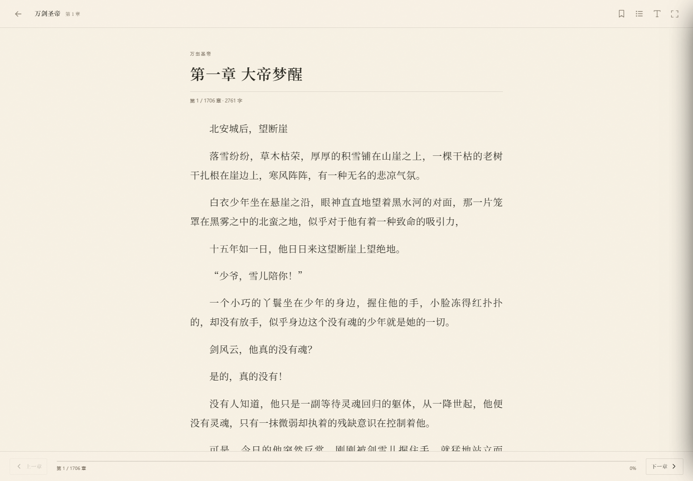

# 墨阅 · MOYUE

> 一盏灯，半卷书。  
> 一间开在本地的小书房：聚合书源、搜索、书架、足迹、书签与护眼阅读器。

墨阅是一个 **本地优先** 的中文小说阅读器。它把七猫中文网与笔趣阁 365 的搜索结果聚在一起，正文只在阅读时即时抓取；账号、书架、阅读进度、书签和偏好都保存在本机的 `data/` 目录里，不上传任何服务器。


## 功能

- **本地账号**：注册 / 登录 / 退出 / 修改密码；密码用 scrypt 加盐哈希，会话走 HttpOnly Cookie。
- **全网寻书**：并行搜索所有启用书源，按书名 + 作者合并去重，标注来源数量与每个源的耗时、命中数。
- **书籍详情**：封面、作者、分类、状态、字数、更新时间、简介、完整目录。
- **书架**：收藏 / 移出；书架内直接续读。
- **阅读足迹**：自动记录章节与章节内百分比，按天分组，可单条删除或全部清空。
- **书签**：一键夹入当前段落，保留摘录与进度；支持跳回原文、删除。
- **护眼阅读器**：宣纸 / 米黄 / 豆绿 / 夜读四套主题；宋体 / 楷体 / 黑体；字号、行距、版心均可调；断点续读、键盘翻页、全屏、目录筛选。
- **书源体检**：单源测试、全源体检、失败修复、启用 / 停用；检测只打轻量入口，不消耗搜索额度。
- **中国风界面**：宣纸底、墨色、朱砂印章、山水留白；桌面侧栏与移动底栏自适应；支持日间 / 夜间界面。

| 书籍详情 | 阅读器 |
| --- | --- |
|  |  |

## 启动

只需要 **Node.js 18 或更高版本**，不需要安装任何第三方依赖。

1. 双击桌面上的 **「墨阅」** 快捷方式，或双击文件夹里的 **`启动 墨阅.bat`**。
2. 启动器会自动寻找空闲端口（默认从 `8737` 开始），启动本地服务并打开浏览器。
3. 关闭启动窗口，或在窗口中按 `Ctrl+C`，即合上书页。

如果书房已经开着，再次双击只会把浏览器重新带到当前地址，不会重复启动服务；启动窗口会保留提示 3 秒后自动关闭。

也可以在命令行启动：

```powershell
npm start          # 直接启动服务，默认 http://127.0.0.1:8737
npm run launch     # 带端口探测和自动打开浏览器
```

### 系统要求

- Windows 10 / 11（启动器与 `.bat` 面向 Windows；服务端和前端本身是跨平台的）
- Node.js 18+（推荐 20 或 24）
- 浏览器：Edge / Chrome / Firefox 等现代浏览器，需支持 ES Modules
- 首次使用某个书源时需要联网

## 使用

1. 打开首页，直接搜索书名或作者；也可以点热词试手。
2. 在结果里选一个书源进入详情。同一本书可能来自多个源，优先展示七猫。
3. 点「开始阅读」进入阅读器。未登录也可以阅读，但书架、足迹、书签需要登录。
4. 右上角或设置页可注册账号；所有数据只写入本机。
5. 阅读器右上角可打开目录、书签与阅读设置；底部有上一章 / 下一章。
6. 「源体检」页可测试书源、自动修复失效域名、临时停用某个源。

### 阅读器快捷键

| 按键 | 动作 |
| --- | --- |
| `←` / `PageUp` | 上一章 |
| `→` / `PageDown` | 下一章 |
| `空格` | 向下翻页 |
| `F` | 全屏 / 退出全屏 |
| `B` | 当前位置加书签 |
| `Esc` | 关闭面板 / 退出阅读器 |

## 书源

内置两个适配器，均可在「源体检」中启停和修复：

| 书源 | 说明 | 搜索特点 |
| --- | --- | --- |
| 七猫中文网 | 正版免费站，字段齐全，有封面、完整目录与全文 | 搜索接口稳定，速度快 |
| 笔趣阁 365 | 镜像站，目录与全文可用 | 搜索约 15 秒一次；过快会返回限流提示 |

书名、作者、封面等版权归原作者与来源站所有。墨阅只在阅读时即时请求正文，不批量缓存整本书，也不提供下载。书源结构可能随时变化；若某个源失效，可在「源体检」里测试并停用，或自行扩展适配器。

### 增加自定义源

在 `server/sources/` 下新增一个适配器，导出：

```js
module.exports = {
  id: 'my-source',
  name: '我的书源',
  async search(keyword, source) { /* 返回书籍数组 */ },
  async detail(bookId, source) { /* 返回书籍 + chapters */ },
  async chapter(bookId, chapterId, source) { /* 返回章节正文 */ },
  async probe(source) { /* 返回 { message: '探活结果' } */ }
};
```

然后在 `server/sources/index.js` 的注册表里挂上适配器，并在 `server/store.js` 的默认 `sources` 中增加一条记录。

## 数据与隐私

- 数据目录：`data/`
  - `data/db.json`：账号、会话、书源、书架、足迹、书签、偏好
  - `data/cache/img/`：封面代理缓存
  - `data/port.txt`：最近一次启动的端口
- 密码只保存 scrypt 哈希与随机盐，不保存明文。
- 会话 Cookie 为 `HttpOnly`、`SameSite=Lax`，默认 30 天；修改密码会注销该账号的其他会话。
- 服务默认只监听 `127.0.0.1`，不对局域网开放。
- 想彻底清空数据：关闭墨阅后删除整个 `data/` 目录，下次启动会自动重建。

> 忘记密码目前没有找回入口。可在退出登录后注册新账号；若必须恢复旧账号，需要手动编辑 `data/db.json`（不推荐，且会丢失该账号的密码校验）。

## 目录结构

```text
.
├─ 启动 墨阅.bat          # Windows 双击启动
├─ launcher.js            # 端口探测、启动服务、打开浏览器
├─ package.json
├─ server/
│  ├─ index.js            # HTTP 服务、API 路由、静态文件、图片代理
│  ├─ auth.js             # 注册、登录、会话、改密
│  ├─ store.js            # JSON 原子持久化与用户数据
│  ├─ http.js             # 抓取、超时、编码、宽松 HTTP 解析
│  ├─ util.js             # 通用工具、SSRF 防护、HTML 清洗
│  └─ sources/
│     ├─ index.js         # 聚合搜索、缓存、体检、故障转移
│     ├─ qimao.js         # 七猫适配器
│     └─ biquge365.js     # 笔趣阁 365 适配器
├─ web/
│  ├─ index.html
│  ├─ styles.css
│  ├─ assets/favicon.svg
│  └─ js/                 # 原生 ES Modules，无构建步骤
│     ├─ app.js           # 路由与页面
│     ├─ reader.js        # 阅读器
│     ├─ api.js
│     ├─ ui.js
│     ├─ util.js
│     └─ icons.js
├─ tools/ui-test.mjs      # 无头 Edge 端到端冒烟测试
├─ screenshots/           # 测试截图
└─ data/                  # 首次启动后生成
```

## 开发

服务端与前端均为原生 JavaScript，零第三方运行时依赖，不需要打包。

```powershell
# 启动（前台）
node server/index.js

# 指定端口并跳过启动自检
$env:PORT='8899'; $env:MOYUE_SKIP_HEALTH='1'; node server/index.js

# 端到端测试：先让服务跑在 8899，再另开一个终端
node tools/ui-test.mjs
```

`tools/ui-test.mjs` 会启动无头 Edge，依次检查首页、聚合搜索、详情、阅读器主题、翻章、登录门槛、注册、书架、断点续读、书签、源体检、设置、移动端布局，并把截图写入 `screenshots/`。需要本机安装 Edge；可用 `EDGE_PATH` 指定其他 Chromium 浏览器，用 `MOYUE_URL` 指定被测地址。测试脚本使用 Node 全局 `WebSocket`，需要 Node.js 22+；软件本身仍支持 Node.js 18+。

### 环境变量

| 变量 | 默认值 | 说明 |
| --- | --- | --- |
| `PORT` | `8737` | 服务端口 |
| `MOYUE_HOST` | `127.0.0.1` | 监听地址 |
| `MOYUE_PORT` | `8737` | 启动器优先尝试的端口 |
| `MOYUE_NO_OPEN` | - | 设为 `1` 时不自动打开浏览器 |
| `MOYUE_SKIP_HEALTH` | - | 设为 `1` 时跳过启动自检 |
| `MOYUE_PORT_FILE` | - | 设为 `0` 时不写 `data/port.txt` |
| `MOYUE_DATA_DIR` | `./data` | 自定义数据目录 |

## 已知边界

- 书源是第三方站点，页面结构、反爬策略和可用性会变化；墨阅不保证任何书源永久可用。
- 笔趣阁 365 的搜索有限流（约 15 秒一次），连续搜索会看到「稍后再试」的提示；这是来源站的行为。
- 目录可能很长（上千章），详情页默认展开前 48 章，可手动「展开全部」。
- 该项目用于个人学习与本地阅读，不提供内容存储、下载或分发能力。请遵守来源站的服务条款与当地法律。

## 许可

代码以 MIT License 发布；小说内容版权归原作者与来源站所有。
